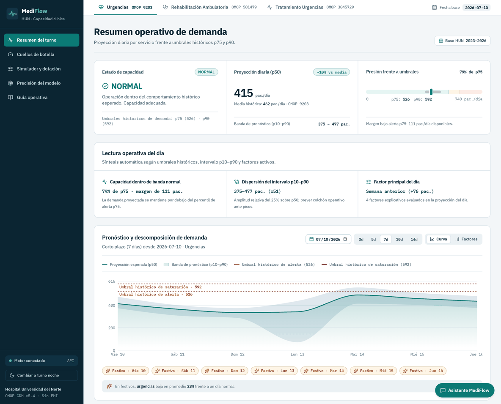
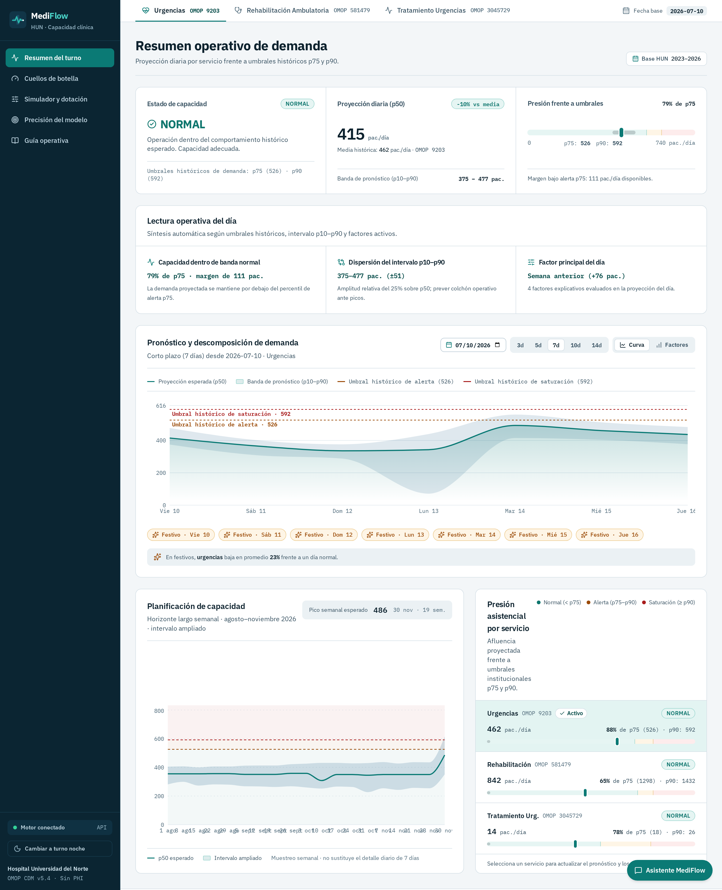
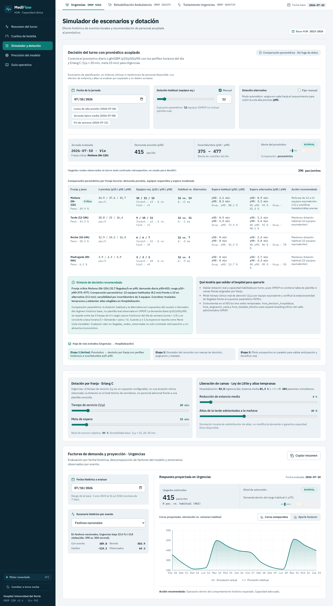
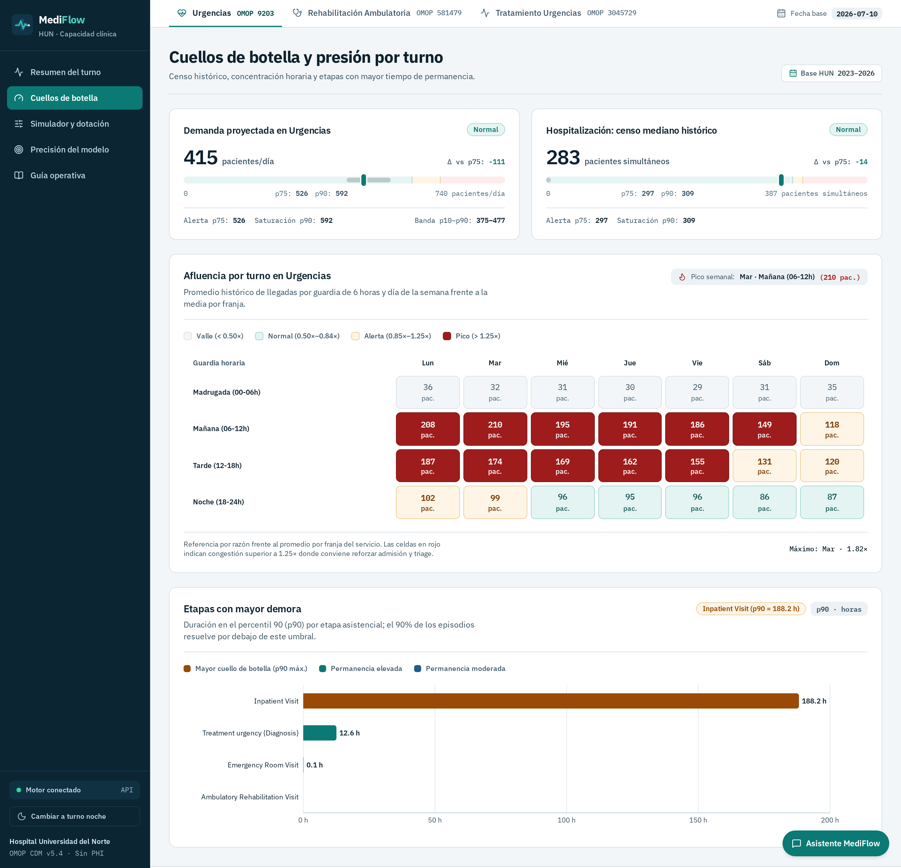
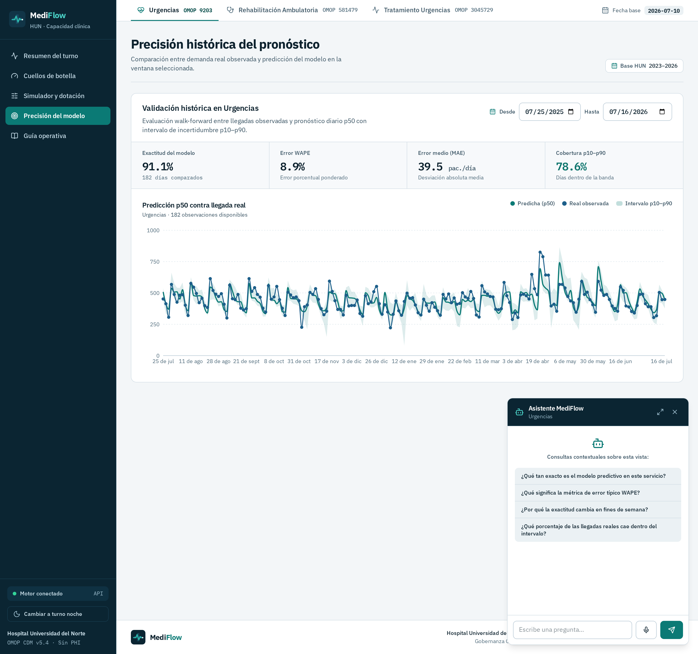

<div align="center">


# MediFlow

**Pronóstico de demanda y planificación de turnos para el Hospital Universidad del Norte.**

[](tests/README.md)
[](docs/resultados/modelo_demanda.md)


[](reports/informe_final.md)
[][powerbi]
[](#aplicación-web)

</div>

## Entregables oficiales

MediFlow ayuda al personal del hospital a anticipar la afluencia de pacientes, identificar dónde se acumula la presión y comparar opciones para el próximo turno. El semáforo, el simulador y el asistente presentan la información en español claro.

| Entregable | Qué incluye |
|---|---|
| [Dashboard Power BI][powerbi] · [Proyecto PBIP][pbip] | Demanda, saturación, esperas y flujo asistencial. |
| [App Web](#aplicación-web) | Pronósticos por servicio, simulador de turnos y asistente. |
| [Informe final](reports/informe_final.md) | Metodología, resultados y recomendaciones. |
| [Código](src/) · [Pruebas](tests/) | Extracción, procesamiento, modelos y validación automatizada. |

## Demo de la app



Capturas de la app. La imagen del simulador reúne tres secciones de la misma vista.

| Pronóstico de demanda | Simulador y optimización |
|---|---|
| [](docs/img/app/dashboard_pronostico.png) | [](docs/img/app/simulador_optimizacion.png) |
| **Cuellos de botella** | **Precisión del modelo** |
| [](docs/img/app/cuellos_botella.png) | [](docs/img/app/precision_asistente.png) |

### Resultados del proyecto

[](reports/informe_final.md)

## Instalación y uso

### Python y pruebas

Desde la raíz del repositorio, con **Python 3.11+**:

```bash
python -m venv .venv
source .venv/bin/activate
pip install -r requirements.txt
pip install -e .
pytest -q
```

### Aplicación web

**Terminal 1 · FastAPI**

```bash
source .venv/bin/activate
HUN_MODO_PRODUCCION=1 HUN_BUNDLE_PATH=models/modelos_web_bundle.joblib \
  uvicorn app.api:app --port 8000
```

**Terminal 2 · React y Vite** (Node.js 22.12+)

```bash
npm --prefix app ci
npm --prefix app run dev
```

Abre `http://localhost:5173` para usar MediFlow y `http://localhost:8000/docs` para explorar la API.

### Power BI

Abre el [tablero publicado][powerbi] en el navegador. Para cargar tus agregados en Power BI Desktop, abre el [proyecto PBIP][pbip], configura `RutaDatos` con la ruta a `data/processed/powerbi/` y pulsa **Actualizar**. Consulta la [guía de conexión](dashboards/README.md#cómo-conectarse-al-modelo) para preparar los archivos.

### Estructura del repositorio

```text
.
├── app/                  API FastAPI y frontend React
├── dashboards/powerbi/   Proyecto PBIP y preparación de datos
├── data/                 Directorios de datos locales
├── docs/                 Documentación técnica y recursos visuales
├── models/               Bundle del modelo para la app
├── notebooks/            Exploración y experimentos
├── reports/              Informe final y figuras
├── src/                  Extracción, variables y modelos
└── tests/                Pruebas automatizadas
```

## Índice documental

- [Informe final](reports/informe_final.md) · [Reportes y figuras](reports/README.md)
- [Documentación técnica](docs/) · [Resultados de modelado](docs/resultados/)
- [Contrato de la API](docs/contrato_modelo_web.md) · [Guía del asistente](docs/guia_chatbot.md)

[powerbi]: https://app.powerbi.com/view?r=eyJrIjoiYjU3YTBhMWItNTM5Mi00NDk4LTlkNmEtMmFmMzA2MzJjZjQ4IiwidCI6ImJhYjBiNjc5LWJkNWYtNGZlOC1iNTE2LWM2YjhiMzE3Yzc4MiIsImMiOjR9
[pbip]: dashboards/powerbi/HUN_CuellosBotella/HUN_CuellosBotella.pbip
