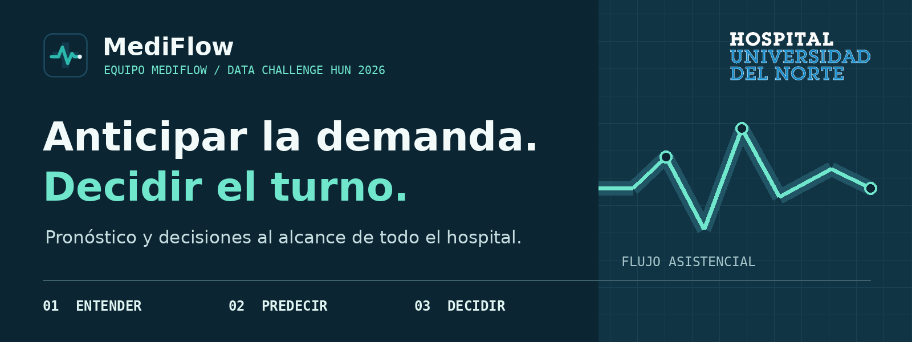
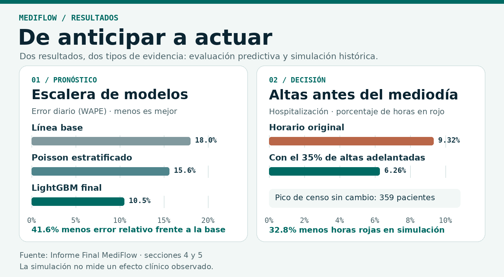
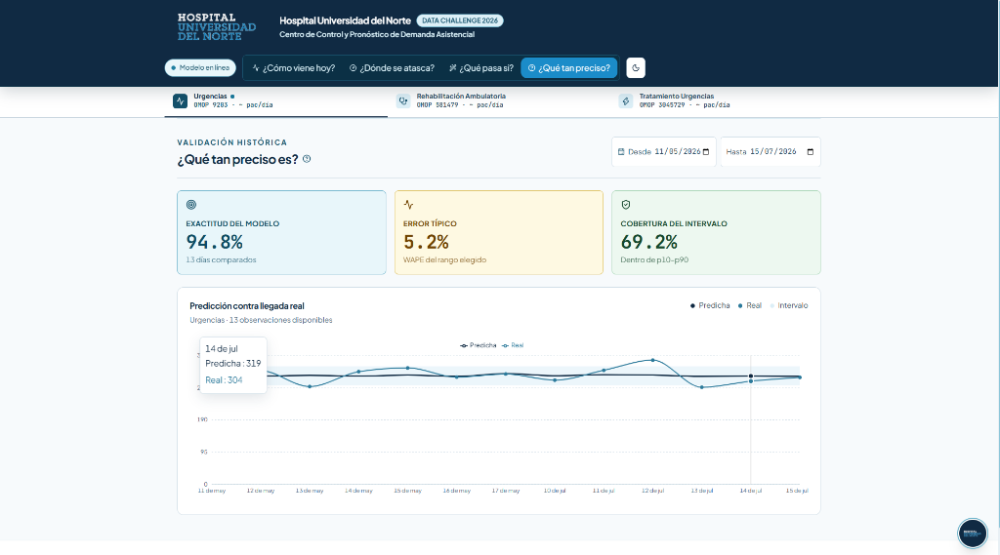
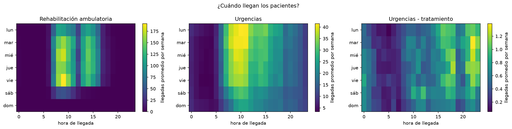
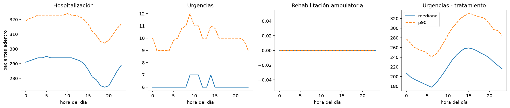
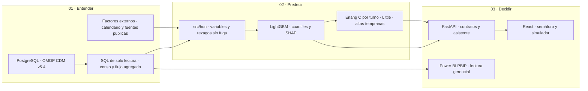

<div align="center">



# MediFlow · Sistema Inteligente de Pronóstico de Demanda, Saturación y Optimización Operacional Hospitalaria (Data Challenge HUN 2026)

**Qué esperar, por qué cambia y qué hacer en el próximo turno.**

[](tests/README.md)
[](docs/resultados/modelo_demanda.md)
[](docs/resultados/modelo_demanda.md)


[](reports/informe_final.md)
[](https://app.powerbi.com/view?r=eyJrIjoiYjU3YTBhMWItNTM5Mi00NDk4LTlkNmEtMmFmMzA2MzJjZjQ4IiwidCI6ImJhYjBiNjc5LWJkNWYtNGZlOC1iNTE2LWM2YjhiMzE3Yzc4MiIsImMiOjR9)
[](#aplicación-web)

[Entregables](#entregables-oficiales) · [Resultados](#resultados-en-un-vistazo) · [Instalación](#instalación-y-reproducción) · [Equipo y datos](#equipo-y-gobernanza)

</div>

## Hecho para el personal del hospital

**MediFlow está diseñado para que cualquier persona del hospital pueda anticipar presión y decidir qué revisar, sin conocimientos técnicos ni de ciencia de datos.** Jefes de servicio, enfermeros jefes, coordinadores de camas y personal administrativo pueden usarlo sin interpretar un modelo ni abrir una consulta SQL.

En el Hospital Universidad del Norte (HUN), saber cuántos pacientes llegarán no basta: también importa **dónde se acumulan, cuánto permanecen y qué alternativas hay para el próximo turno**. MediFlow organiza esa tarea en tres capas: **Entender** el flujo y sus cuellos de botella → **Predecir** la demanda y su rango probable → **Decidir** qué alternativa vale la pena evaluar. OMOP CDM, LightGBM cuantílico, SHAP, Erlang C y la Ley de Little respaldan la respuesta; no son requisitos para usar la herramienta.

| Lo que necesita saber el equipo | Lo que muestra MediFlow |
|---|---|
| **¿Qué presión esperamos?** | **Semáforo asistencial:** 🟢 **Verde**, operación habitual; 🟡 **Amarillo**, vigilar y preparar contingencias; 🔴 **Rojo**, evaluar un refuerzo. Las alertas comparan la demanda o el censo con su propio historial; no miden camas habilitadas ni sustituyen protocolos clínicos. |
| **¿Por qué cambia la demanda?** | **Explicaciones en lenguaje natural**, no solo gráficos estadísticos. Ejemplo ilustrativo: «El modelo estima 38 pacientes más por el efecto de un lunes después de un festivo». Es un aporte al pronóstico, no una atribución causal. |
| **¿Qué podemos ajustar en este turno?** | En **«¿Qué pasa si?»**, el coordinador cambia controles simples —turno, demanda o equipos equivalentes— y compara alternativas. Por ejemplo: «Evaluar pasar de 12 a 15 equipos en la mañana» o «Adelantar antes del mediodía el 35% de las altas elegibles». El panel muestra qué cambiaría y bajo qué supuestos. |
| **¿Cómo lo consulto sin recorrer todos los paneles?** | El **asistente conversacional** (`/api/chat`) acepta preguntas en español cotidiano: «¿Qué se espera hoy en Urgencias y qué puedo revisar para el turno de la mañana?». El **tablero Power BI** ofrece una lectura gerencial rápida de demanda, presión y esperas históricas. |

## Entregables oficiales

**Sección 13 de los Términos y Condiciones.** El tablero y el informe son los entregables formales; la aplicación y el repositorio permiten probar y reproducir la solución.

| Entregable | Qué encuentra el jurado |
|---|---|
| 📊 **Dashboard interactivo** · [Abrir tablero público en Power BI][powerbi] | [Proyecto PBIP](dashboards/powerbi/HUN_CuellosBotella/) versionado sin datos: modelo estrella de **12 tablas, 18 relaciones y 43 medidas DAX**. [Siete páginas interactivas](dashboards/README.md): Inicio, Resumen ejecutivo, Saturación por área, Esperas y flujo, Demanda, Hallazgos y recomendaciones, Metodología y glosario. |
| 📄 **[Informe final técnico y ejecutivo](reports/informe_final.md)** · Markdown pre-LaTeX | Correspondencia 1:1 con los siete criterios de la **Sección 14**: **15%** flujo, **15%** calidad de datos, **20%** modelo predictivo, **20%** optimización operacional, **15%** visualización/web/Power BI, **5%** ingeniería y reproducibilidad, **10%** recomendaciones accionables. |
| 🖥️ **[Aplicación web, simulador y asistente](app/)** · [Ejecutar en local](#aplicación-web) | React + FastAPI: pronóstico cuantílico `p10/p50/p90`, explicaciones SHAP, radar de presión y comparación real vs. predicho. Simula Erlang C por turno con demanda pronosticada, Ley de Little y altas tempranas. El asistente usa **seis herramientas deterministas de solo lectura** y no consulta registros individuales. |
| 🧪 **[Repositorio reproducible](src/hun/) y [suite de validación](tests/)** | **24 [consultas SQL](src/hun/data/sql/) de solo lectura** sobre OMOP CDM, pipeline de factores externos con [protocolo contra asociaciones espurias](docs/protocolo_factores_externos.md) y **176 pruebas automatizadas**. |

## Resultados en un vistazo

[](reports/informe_final.md)

**Pronóstico:** 41.6% menos error relativo frente a la línea base. **Operación:** adelantar el 35% de las altas de tarde redujo las horas rojas un 32.8% en la simulación histórica, sin bajar el pico de censo. Son dos evaluaciones distintas: la segunda no demuestra un efecto clínico observado.



*Captura real de «¿Qué tan preciso es?». Los indicadores en pantalla corresponden a 13 observaciones seleccionadas; el resultado del backtest completo de Urgencias es **91.6% de exactitud (WAPE 8.4%)**.*

<details>
<summary><strong>Ver evidencia exploratoria:</strong> llegadas por día y hora · censo por etapa</summary>

**Llegadas.** Urgencias concentra actividad en la mañana; Rehabilitación es predominantemente diurna y laboral.



**Censo por etapa.** Llegadas y ocupación no son lo mismo. El censo cuenta pacientes concurrentes, no camas habilitadas. Para cifras finales, consultar el [análisis de saturación con filtro `p99.9`](docs/resultados/saturacion.md).



</details>

## Informe final en un vistazo

**Corte documental: 19 de noviembre de 2026.** El [informe final](reports/informe_final.md) documenta las poblaciones, corridas y supuestos detrás de cada cifra.



### 01 · Entender: auditar antes de medir presión

- **Auditoría OMOP:** desplazamiento estimado de **0 días**; deduplicación del **13.38%** de copias sobrantes en `visit_occurrence`. Las duraciones se reconstruyen con `visit_detail`, no con la visita principal.
- **Colas extremas:** `SQL14/15/16` aplican el tope `p99.9` por etapa a entradas, salidas y duraciones; `SQL23` calcula y documenta el umbral sobre las duraciones válidas sin recorte.
- **Reconciliación en PostgreSQL:** en Hospitalización el stock inicial fue $N_0 = 0$ y la diferencia entre censo reconstruido y conteo directo fue **0 en los 12 cortes horarios**. Con el filtro común `p99.9`, $\lambda \times W$ dio **277.52 pacientes** frente a **277.47** de censo medio horario en **1,294 días**. Tras **24 días de calentamiento**, la media fue **278.61** y la mediana **283.0**. La mediana de Tratamiento Urgencias fue **201.0**.

[Auditoría de calidad](docs/calidad_datos.md) · [Reconstrucción y umbrales de censo](docs/resultados/saturacion.md) · [Verificación PostgreSQL](reports/informe_final.md#3-calidad-preparación-e-integración-de-los-datos-15-)

### 02 · Predecir: medir el error sin mirar el futuro

**Walk-forward diario:** 26 pliegues y pronóstico de **1–7 días**. WAPE mide el error absoluto acumulado respecto al volumen real; la «exactitud» que se reporta es **1 − WAPE**, no el porcentaje de días acertados.

| Modelo | WAPE diario | Mejora relativa vs. base |
|---|---:|---:|
| Línea base · mediana de 8 semanas | 18.0% | — |
| Poisson estratificado por servicio | 15.6% | 13.2% |
| **LightGBM final** (`lgbm_final`) | **10.5%** | **41.6%** |

- **Por servicio:** Urgencias **91.6%** de exactitud; Rehabilitación **89.0%**; Tratamiento Urgencias **56.5%** en resolución diaria. Rehabilitación pierde precisión en fines de semana de bajo volumen.
- **Planeación a 120 días:** **84.3%** de exactitud y **86.5%** de cobertura observada del intervalo en 13 pliegues. Es una evaluación separada del horizonte operativo semanal.
- **Factores externos:** ablación en los mismos pliegues, control de estacionalidad, placebo temporal y estabilidad. Se aceptan `festivos_y_puentes` y `carnaval_y_semana_santa`; se descartan clima, epidemiología, vacaciones escolares y quincenas/primas. SHAP explica el aporte al pronóstico de un factor, no su efecto causal.

[Evaluación de demanda](docs/resultados/modelo_demanda.md) · [Intervalos y explicabilidad](docs/resultados/intervalos_shap.md) · [Backtest de largo plazo](docs/resultados/largo_plazo.md)

### 03 · Decidir: comparar alternativas de turno y egreso

El motor reparte la demanda diaria pronosticada entre franjas con perfiles históricos y usa **Erlang C** para estimar equipos equivalentes y espera bajo distintas cargas. La **Ley de Little** estima cómo cambiaría la ocupación media si baja la estancia a tasa de ingresos fija; el escenario usa la referencia híbrida del bundle v2.0 (**284.01**), distinta de la comprobación poblacional de **277.52**. La **simulación de altas** mueve egresos agregados, manteniendo los ingresos y el umbral rojo histórico (>309 pacientes).

| ID | Acción propuesta | Evidencia para decidir | Qué validar antes de actuar |
|---|---|---|---|
| **REC-01** | Evaluar refuerzo en Urgencias, **06–12 h** | Demanda histórica alta de **39.67 llegadas/h**: **15 equipos equivalentes** frente a 12 en régimen normal; espera media modelada **6.09 min** con 15. | Atención media de 20 min y dotación real; un equipo equivalente no es una orden de contratación. |
| **REC-02** | Revisar capacidad de Rehabilitación, **06–12 h** | Demanda histórica alta de **133.33 llegadas/h**: **70 equipos equivalentes** frente a 42; espera media modelada **5.30 min** con 70. | Atención media de 30 min, agenda y capacidad simultánea. |
| **REC-03** | Reducir **4 h** de estancia evitable en Hospitalización | **13.97 camas medias equivalentes** liberadas teóricamente (**4.92%** del censo Little). | Identificar demoras evitables y mantener criterios clínicos de egreso. |
| **REC-04** | Adelantar a **08–12 h** el **35%** de las altas elegibles de **14–20 h** | Horas rojas **9.32% → 6.26%**; pico **359 → 359** en la simulación. | Coordinar alta médica, trámites y salida; evaluar el piloto con umbral fijo. |
| **REC-05** | Auditar la transición Tratamiento Urgencias → Hospitalización | **47,670 pasos**; **24.45 h** de p90 mensual ponderado. La correlación mensual con el censo (**r = −0.48**) no respalda una atribución causal simple. | Contrastar en el HIS decisión, asignación y traslado; la diferencia entre sellos OMOP no equivale a espera por cama. |

**Siguiente paso para el HUN:** validar dotación y marcas del HIS, probar en modo sombra y pilotar el egreso temprano con supervisión. MediFlow apoya decisiones; no automatiza contrataciones ni altas clínicas. [Supuestos, simulaciones y recomendaciones](docs/resultados/optimizacion.md#recomendaciones-cuantificadas).

## Instalación y reproducción

### Entorno y pruebas

Desde la raíz del repositorio, con **Python 3.11+**. Para la web, usar **Node.js 22.12+**.

```bash
python -m venv .venv
source .venv/bin/activate
pip install -r requirements.txt && pip install -e .
.venv/bin/pytest -q
```

La suite debe reportar **`176 passed`**. En Windows, activar con `.venv\Scripts\Activate.ps1` y ejecutar `pytest -q`. Para preparar tu entorno local, copia [`.env.example`](.env.example) a `.env` si aún no existe. Las credenciales de PostgreSQL no son necesarias para ejecutar la suite.

### Aplicación web

Ejecuta los siguientes comandos desde la raíz, en dos terminales:

```bash
# Terminal 1 · FastAPI (con .venv activo)
uvicorn app.api:app --reload --port 8000
```

```bash
# Terminal 2 · React + Vite
npm --prefix app ci
npm --prefix app run dev
```

Abre `http://localhost:5173` para explorar la app y `http://localhost:8000/docs` para consultar la API. El proxy de Vite conecta el frontend con el backend local. [Guía de la app](app/README.md) · [Contrato API](docs/contrato_modelo_web.md) · [Guía del asistente](docs/guia_chatbot.md).

**Producción estricta (o demo local con el bundle autorizado, sin VPN):**

```bash
HUN_MODO_PRODUCCION=1 HUN_BUNDLE_PATH=models/modelos_web_bundle.joblib \
  uvicorn app.api:app --port 8000
```

La API carga modelos y salidas agregadas del bundle, **no** lee `data/` ni usa respaldo sintético. Si el bundle falta, los endpoints que dependen de él reportan `503`. Para desplegar en orígenes separados, configura `ALLOWED_ORIGINS` en la API y `VITE_API_URL` antes de `npm --prefix app run build`. Regenerar modelos y evidencias requiere agregados autorizados; consulta los [comandos del informe](reports/informe_final.md#comandos-de-reproducción) y la [guía de acceso por VPN](docs/guia_sesion_bd.md).

### Power BI: explorar o conectar

1. **Explorar sin instalación:** [abre el tablero público oficial][powerbi].
2. **Inspeccionar o actualizar el proyecto:** abre [`HUN_CuellosBotella.pbip`](dashboards/powerbi/HUN_CuellosBotella/HUN_CuellosBotella.pbip) en Power BI Desktop. El proyecto no incluye datos.
3. **Cargar los agregados autorizados:** sigue la [guía de extracción y conexión](dashboards/README.md#cómo-conectarse-al-modelo), configura `RutaDatos` con tu carpeta local `data/processed/powerbi/` y pulsa **Actualizar**.

### Estructura del repositorio

```text
.
├── app/                          # FastAPI (api/), interfaz React (src/) e identidad (public/)
├── dashboards/powerbi/           # Proyecto PBIP y preparación del modelo estrella
├── data/                         # Carpetas locales de intercambio y documentación
├── docs/                         # Auditorías, contratos, resultados e imágenes del README
├── models/                       # Artefactos de modelos; bundle de inferencia web
├── notebooks/                    # Exploración, preparación y modelado
├── reports/                      # Informe final y figuras exploratorias
├── src/
│   ├── external/                 # Descarga y consolidación de factores externos
│   └── hun/                      # SQL, auditoría, variables, modelos y visualización
└── tests/                        # Pruebas unitarias y de integración
```

## Equipo y gobernanza

| Equipo MediFlow | Rol y responsabilidad |
|---|---|
| **Krlos** | Modelos de demanda y factores externos; integración, repositorio y documentación. |
| **Daniel** | Liderazgo de desarrollo web y validación del modelo. |
| **Juan** | Preparación y análisis de datos, cuellos de botella y tablero Power BI. |

> [!CAUTION]
> **Los datos del HUN son confidenciales.** En cumplimiento de las Secciones **6 y 20** de los Términos y Condiciones, no se suben datos crudos, archivos `.parquet` o `.pbix`, exportaciones clínicas, credenciales ni notebooks con salidas sensibles. La extracción OMOP es de solo lectura y trabaja con agregados; cualquier publicación requiere control de reidentificación. El PBIP versiona definiciones, no datos. Intercambia artefactos privados solo por el canal autorizado por el hospital.

**Contribución:** sigue [`CONTRIBUTING.md`](CONTRIBUTING.md): rama enfocada, PR a `develop`, revisión de otro integrante, pruebas y checklist de datos sensibles. Usa `pre-commit install` para activar los controles locales. El repositorio no incluye un archivo `LICENSE`; la publicación del código no autoriza la redistribución de datos hospitalarios.

### Índice documental

| Área | Documentación |
|---|---|
| **Entrega** | [Informe final](reports/informe_final.md) · [Reportes y figuras](reports/README.md) · [Índice de documentación](docs/README.md) |
| **Datos OMOP** | [Auditoría](docs/calidad_datos.md) · [Inventario](docs/inventario_base.md) · [Hallazgos](docs/hallazgos.md) · [Cierre de datos](docs/cierre_datos.md) · [Diccionario y consultas](docs/diccionario_datos.md) · [Diccionario extendido](docs/diccionario_datos/Diccionario_datos.md) · [Sesión segura de base de datos](docs/guia_sesion_bd.md) |
| **Método** | [Objetivo predictivo](docs/objetivo_prediccion.md) · [Decisiones de arquitectura](docs/decisiones.md) · [Fuentes externas](docs/datos_externos.md) · [Protocolo de factores](docs/protocolo_factores_externos.md) |
| **Resultados** | [Índice](docs/resultados/README.md) · [Línea base horaria](docs/resultados/linea_base.md) · [Línea base diaria](docs/resultados/linea_base_diaria.md) · [Demanda](docs/resultados/modelo_demanda.md) · [Factores externos](docs/resultados/factores_externos.md) · [Intervalos y SHAP](docs/resultados/intervalos_shap.md) · [Largo plazo](docs/resultados/largo_plazo.md) · [Saturación](docs/resultados/saturacion.md) · [Optimización](docs/resultados/optimizacion.md) · [Validación independiente histórica](docs/resultados/validacion_independiente.md) |
| **Producto y proyecto** | [Contrato modelo–web](docs/contrato_modelo_web.md) · [Guía del asistente](docs/guia_chatbot.md) · [Sprint 1](docs/sprints/sprint_1.md) · [Guía de Power BI](dashboards/README.md) · [Generador del banner y resumen visual](docs/img/generar_visuales.py) |

**Nota académica:** proyecto del Equipo MediFlow para el **Data Challenge HUN 2026**, Universidad del Norte y Fundación Hospital Universidad del Norte. Herramienta de apoyo a la planeación hospitalaria, no un protocolo clínico.

[powerbi]: https://app.powerbi.com/view?r=eyJrIjoiYjU3YTBhMWItNTM5Mi00NDk4LTlkNmEtMmFmMzA2MzJjZjQ4IiwidCI6ImJhYjBiNjc5LWJkNWYtNGZlOC1iNTE2LWM2YjhiMzE3Yzc4MiIsImMiOjR9
