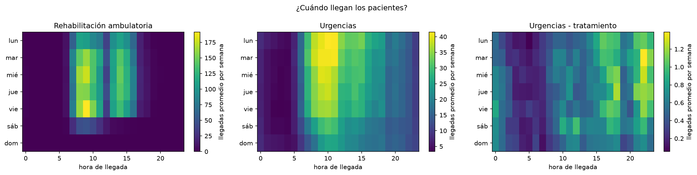
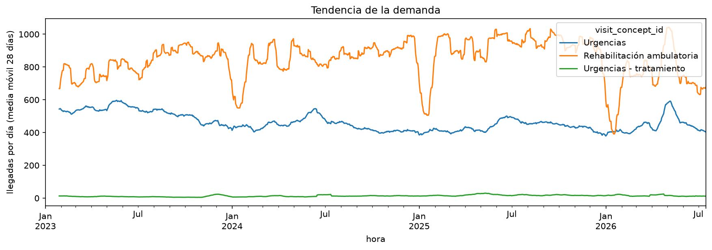

# Informe Final — Data Challenge HUN 2026 (Equipo MediFlow)

**Hospital Universidad del Norte · Corte documental: 19 de noviembre de 2026**

MediFlow convierte agregados hospitalarios OMOP en una solución para comprender el flujo, anticipar demanda y evaluar decisiones operacionales. Este documento consolida metodología, resultados, conclusiones y recomendaciones como informe final de la Sección 13. Tras el resumen ejecutivo, las secciones 2–8 corresponden, una a una, a los siete criterios de evaluación de la Sección 14; sus pesos suman 100 %.

**Equipo:** Krlos (modelos, integración y documentación), Daniel (web y validación) y Juan (preparación, análisis y Power BI). El trabajo se organiza iterativamente por sprints y revisiones de entregables, sin atribuir una duración semanal fija.


## Estado verificable del artefacto servido (cierre local, 19 de noviembre de 2026)

Esta sección distingue la documentación experimental de lo que contiene el archivo entregado. No se regeneró el bundle ni se consultó PostgreSQL en este cierre.

- Bundle **v2.0**, corte exclusivo **2026-07-17**; SHA-256 `be8252b056377f8820808a518095235c1215b6ad5c3466a781bad6a0f0ad1e28`.
- Modelo servido: **LightGBM cuantílico**, diferente del experimento Poisson `lgbm_final` con WAPE global 10.5%.

| Servicio | WAPE archivado del bundle | Cobertura archivada p10–p90 | Días evaluados |
|---|---:|---:|---:|
| Urgencias | 8.91% | 78.57% | 182 |
| Rehabilitación | 11.08% | 64.29% | 182 |
| Tratamiento Urgencias | 42.18% | 73.08% | 182 |

La cobertura usa predicciones antes del redondeo de los puntos para la web. Recalcular sobre enteros puede cambiarla. Estas cifras son resultados archivados, no una reejecución del entrenamiento. La auditoría de intervalos del 3 de noviembre es otro corte y no certifica este bundle.

El selector de optimización distingue **histórico retrospectivo** de **pronóstico con perfil anterior al corte**. El primero permite una prueba funcional; puede usar información posterior a la jornada histórica y no demuestra ausencia de fuga. El segundo valida perfiles por corte, pero el v2.0 carece de `perfiles_horarios`: muestra indisponibilidad explícita. Solo las pruebas sintéticas comprueban el recorrido completo del formato v2.1. La API `/api/modelo` permite consultar versión, huella, capacidades y métricas archivadas.

Little mantiene **284.01** en el v2.0, con poblaciones distintas. El valor **277.52** es una reconciliación hospitalaria documentada, no reejecutada en este cierre ni aplicada al bundle. El frontend muestra esa diferencia.

Power BI conserva un corte **2026-04-30**, distinto del corte de demanda. Se corrigieron localmente los textos que equiparaban la transición OMOP a espera de cama o prometían una reducción causal. **El enlace público no incorpora esas correcciones hasta su republicación autorizada.**

El simulador del recorrido con capacidad real y tres marcas HIS continúa en diseño. El piloto prospectivo continúa pendiente. El documento histórico de validación no constituye aprobación clínica. La entrega y la sustentación deben comprobarse con la organización; disponer de archivos locales no prueba su recepción.

## 1. Resumen ejecutivo

El problema no es únicamente anticipar cuántos pacientes llegan: es conectar esa demanda con la permanencia en cada etapa y las posibilidades reales de atención y egreso. OMOP no incluye capacidad instalada ni una tabla de dotación; por ello distinguimos presión histórica, requerimientos paramétricos y capacidad física.

La solución tiene tres capas: **entender** (auditoría, etapas y cuellos de botella), **predecir** (llegadas, incertidumbre y horizonte extendido) y **decidir** (semáforos, explicaciones y escenarios). Un módulo de **optimización operacional** integra Erlang C, Ley de Little y simulación horaria de altas tempranas.

| Resultado verificado | Lectura para decisión | Fuente |
|---|---|---|
| WAPE diario: 18.0% → 15.6% → 10.5% | Línea base → Poisson estratificado → `lgbm_final`; mejora relativa final 41.6% frente a la base | [Demanda](../docs/resultados/modelo_demanda.md) |
| Urgencias: WAPE 8.4%, exactitud 91.6%; Rehabilitación: WAPE 11.0%, exactitud 89.0% | Buen desempeño global en servicios de alto volumen, no garantía por cada día | [Demanda](../docs/resultados/modelo_demanda.md) |
| Censo mediano: Hospitalización 283.0; Treatment urgency 201.0 | Presión de pacientes concurrentes (extracto depurado `p99.9`), no número de camas habilitadas | [Saturación](../docs/resultados/saturacion.md) |
| Little: 277.52 pacientes con filtro común `p99.9`; censo medio horario: 277.47 | Comprobación de consistencia interna en 1,294 días; el bundle v2.0 conserva el cálculo híbrido de 284.01 | Verificación PostgreSQL, sección 3 |
| Altas adelantadas 35%: horas rojas 9.32% → 6.26% | Reducción relativa 32.8% en simulación histórica; el pico permanece en 359 | [Optimización](../docs/resultados/optimizacion.md) |
| Urgencias → Hospitalización: 47.670 pasos, p90 mensual ponderado 24.45 h | Señal para auditar transiciones y marcas temporales; no prueba causal de boarding | [Optimización](../docs/resultados/optimizacion.md) |

### Cinco recomendaciones cuantificadas

| ID | Acción propuesta | Resultado observado o modelado | Condición para implementar |
|---|---|---|---|
| REC-01 | Planificar equipos equivalentes de Urgencias en 06–12 h | A demanda p90 39.67/h: 15 equipos frente a 12 del régimen normal; espera media modelada 6.09 min | Validar atención media de 20 min y dotación real; no significa contratar tres personas |
| REC-02 | Planificar equipos equivalentes de Rehabilitación en 06–12 h | A demanda p90 133.33/h: 70 equipos frente a 42 del régimen normal; espera media 5.30 min | Validar atención media de 30 min, agenda y capacidad simultánea |
| REC-03 | Revisar demoras evitables para reducir estancia de Hospitalización | Reducir 4 h libera teóricamente 13.97 camas medias, 4.92% del censo Little | Mantener criterios clínicos; comprobar factibilidad y resultados del piloto |
| REC-04 | Adelantar a 08–12 h el 35% de altas elegibles de 14–20 h | Horas rojas 9.32% → 6.26%; pico 359 → 359 | Coordinar alta médica, trámites y salida; evaluar con umbral fijo |
| REC-05 | Auditar Treatment urgency → Inpatient Visit | 47.670 pasos; p90 mensual ponderado 24.45 h; r mensual con censo = -0.48 | Revisar sellos temporales y causas de demora; no prometer una reducción causal |

Todos los impactos proceden de [REC-01 a REC-05](../docs/resultados/optimizacion.md#recomendaciones-cuantificadas). Son hipótesis operativas cuantificadas, no efectos clínicos demostrados.

## 2. Comprensión del problema y análisis del flujo hospitalario (15 %)

### Unidad de análisis y recorrido

La demanda se mide como llegadas diarias por `visit_concept_id`: **Emergency Room Visit (9203)**, **Ambulatory Rehabilitation Visit (581479)** y **Treatment urgency {Diagnosis} (3045729)**. Hospitalización tiene pocas visitas principales y se agrupa en «Otros» para evaluar demanda; esto no implica poca ocupación: **Inpatient Visit (9201)** sí es una etapa frecuente en `visit_detail`.

`visit_occurrence` tiene inicio y fin iguales y no sirve para estimar permanencia. Se reconstruyen etapas y transiciones con `visit_detail`, separando llegadas, duración, espera entre etapas y censo. Los conceptos OMOP describen registros administrativos y no se equiparan automáticamente a unidades físicas.

### Patrones temporales y presión

La exploración muestra afluencia matutina en Urgencias y actividad predominantemente diurna y laboral en Rehabilitación, con descensos en fines de semana, festivos, Carnaval y fin de año. Se diferencian estos patrones descriptivos de la contribución predictiva validada de cada factor.





Estas figuras son material exploratorio; las cifras finales proceden de las tablas de resultados enlazadas, no de estimaciones visuales.

El censo horario se reconstruye sumando al stock inicial las entradas acumuladas y restando las salidas acumuladas. Los percentiles se calculan después de 24 días de calentamiento; ese descarte no corrige un stock inicial omitido. En Hospitalización se verificó que el stock al inicio del extracto era cero (sección 3).

| Etapa | Censo mediano | p75 | p90 |
|---|---:|---:|---:|
| Inpatient Visit | 283.0 | 297.0 | 309.0 |
| Treatment urgency | 201.0 | 239.0 | 272.0 |
| Emergency Room Visit | 0.0 | 1.0 | 3.0 |

Fuente: [saturación](../docs/resultados/saturacion.md) (extracto horario con filtro `p99.9`). Verde corresponde a censo < p75; amarillo a p75 ≤ censo ≤ p90; rojo a censo > p90. Son umbrales históricos, no límites clínicos de seguridad.

En Hospitalización, la Ley de Little contrasta **medias**, no medianas: con el mismo filtro `p99.9` para ingresos y estancias, da **277.52 pacientes** frente a un censo medio horario de **277.47** en 1,294 días. Tras el calentamiento, la media horaria es **278.61** y la mediana es **283.0**. La sección 3 separa el efecto de los bordes de la ventana del cambio de población en el bundle v2.0.

### Transición prioritaria

Treatment urgency → Inpatient Visit registra **47.670 pasos**, p50 mensual ponderado **0.0 h** y p90 mensual ponderado **24.45 h**. `espera_h` se define como `start_siguiente - end_anterior` en OMOP y admite solapamientos negativos. No equivale necesariamente al tiempo de asignación de cama ni al boarding clínico.

El p90 reportado es un promedio de percentiles mensuales ponderado por pasos, no el percentil exacto del conjunto. La correlación ecológica mensual con censo es **r = -0.48** (-0.481); los p90 ponderados en censo normal y alto son **25.13 h** y **23.70 h**, respectivamente. No hay evidencia aquí para atribuir la demora a congestión ni para prometer su reducción mediante altas tempranas.

## 3. Calidad, preparación e integración de los datos (15 %)

### Auditoría y limpieza

La [auditoría OMOP](../docs/calidad_datos.md) comprueba completitud, duplicados, secuencias temporales, edades y coherencia del calendario. El desfase estimado es **0 días**, sustentado principalmente en el cierre de Rehabilitación en festivos; Urgencias por sí sola no permite decidir por su operación continua.

| Regla | Aplicación y razón |
|---|---|
| Deduplicar visitas | Agrupar por `(person_id, visit_concept_id, visit_start_datetime)` antes de contar llegadas; 13.38% de copias sobrantes en `visit_occurrence` |
| Validar etapas | Excluir etapas sin marcas válidas o con fin anterior al inicio. Para el censo y la duración alineados se conservan etapas sin visita padre; exigir padre define una cohorte distinta |
| Reclasificar edad imposible | Marcar como `invalida` edades < 0 o > 110 años; no asignarlas al grupo pediátrico |
| Trabajar con agregados | Exportar conteos horarios, duraciones y transiciones, no filas individuales |

La auditoría registra 0.43% de duplicados sobrantes en `visit_detail`; no debe confundirse con la tasa de `visit_occurrence`.

### Estancias extremas y depuración aplicada (`p99.9`)

La auditoría completa de `duracion_etapas_percentiles.parquet` (`23_duracion_etapas_percentiles.sql`) documenta los máximos crudos sin recorte (**28,070.3 h** en Treatment urgency, **20,730.3 h** en Emergency Room Visit y **11,213.6 h** en Inpatient Visit) junto con los umbrales `p99.9` por etapa (**1,176.3 h** en Inpatient Visit, **283.7 h** en Treatment urgency, **17.5 h** en Emergency Room Visit y **0.0 h** en Ambulatory Rehabilitation Visit).

SQL23 calcula los percentiles sobre duraciones válidas sin recorte; SQL14 y SQL15 aplican esos umbrales a entradas y salidas. Se reextrajeron con `--refrescar` los agregados `duracion_etapas_percentiles.parquet`, `etapas_entradas_por_hora.parquet` y `etapas_salidas_por_hora.parquet`. Al excluir las estancias por encima del umbral, los percentiles horarios p50 / p75 / p90 de Hospitalización pasaron de `288 / 306 / 319` (máximo `378`) a **`283 / 297 / 309`** (máximo **`359`**); los de Treatment urgency pasaron de `219 / 260 / 300` a **`201 / 239 / 272`**, y Urgencias quedó en **`0 / 1 / 3`**. El recorte es estadístico, no una determinación de error clínico. Véase la [nota metodológica de saturación](../docs/resultados/saturacion.md).

### Verificación de stock inicial, alineación de poblaciones y contraste de Ley de Little en Hospitalización (`9201`)

Las consultas de verificación A y B se ejecutaron directamente en PostgreSQL del HUN. Para `9201` hay **108,601 etapas válidas** en el universo global: ninguna sin fin ni con fin anterior al inicio. El `p99.9` de duración es **1176.257222 h** (1,176.3 h redondeadas). Las **107** etapas que superan ese umbral tienen visita padre; las **91** huérfanas duran menos de 720 h. Así, el filtro común conserva **108,494** etapas y, si además se exige padre, quedan **108,403**.

**A. Balance por corte horario.** El stock a `2023-01-01 00:00:00` fue **$N_0 = 0$** en los cuatro modos comprobados: `bruta`, `sql14_15_16_p999`, `padre_y_p999` y `sql16_antiguo_padre`. La tabla usa la regla común `p99.9` (108,494 etapas, incluidas las huérfanas). Para cada corte $t$, $E$ y $S$ acumulan entradas y salidas **anteriores** a $t$; el conteo directo usa `inicio < t AND fin >= t`.

| Corte horario $t$ | Entradas $E$ | Salidas $S$ | Reconstruido $N_0 + E - S$ | Conteo directo | Diferencia |
|---|---:|---:|---:|---:|---:|
| `2023-01-01 00:00` (stock inicial) | 0 | 0 | 0 | 0 | 0 |
| `2023-01-01 04:00` | 3 | 0 | 3 | 3 | 0 |
| `2023-01-01 15:00` | 15 | 1 | 14 | 14 | 0 |
| `2023-01-02 00:00` | 37 | 2 | 35 | 35 | 0 |
| `2023-01-03 00:00` | 120 | 27 | 93 | 93 | 0 |
| `2023-01-25 04:00` (tras calentamiento) | 2,232 | 1,959 | 273 | 273 | 0 |
| `2024-06-15 12:00` | 44,576 | 44,282 | 294 | 294 | 0 |
| `2025-12-01 18:00` | 91,583 | 91,304 | 279 | 279 | 0 |
| `2026-07-17 07:00` (cierre del bloque de última entrada) | 108,494 | 108,178 | 316 | 316 | 0 |
| `2026-07-18 00:00` (cierre del día 1,294) | 108,494 | 108,216 | 278 | 278 | 0 |
| `2026-07-18 05:00` | 108,494 | 108,216 | 278 | 278 | 0 |
| `2026-07-18 06:00` (cierre del bloque de última salida) | 108,494 | 108,494 | 0 | 0 | 0 |

La diferencia también fue **0 en los 12 cortes** de la cohorte bruta (108,601 etapas). Sus censos, en el mismo orden, fueron 0, 3, 14, 35, 93, 273, 297, 291, 331, 293, 293 y 0. Esto verifica el balance de las etapas registradas, no el número de camas habilitadas.

**B. Ley de Little y poblaciones.** La tasa $\lambda$ usa los 1,294 días de ingresos; $W$ es la **media** de las duraciones completas. El censo medio continuo es el área de las estancias **dentro de la ventana** dividida por sus horas; el horario es el promedio de los conteos por hora. La mediana describe la distribución horaria, no es el término de comparación de Little.

| Regla | Etapas para $E,S$ / para $W$ | $\lambda$ (/día) | $W$ (h) | $\lambda W$ reportado (pacientes) | Censo medio continuo (1,294 d) | Censo medio horario (1,294 d / tras 24 d) | Censo mediano horario (tras 24 d) |
|---|---:|---:|---:|---:|---:|---:|---:|
| `sql14_15_16_p999` (incluye huérfanas) | 108,494 / 108,494 | 83.843895 | 79.438491 | **277.5177** | **277.4669** | **277.4706 / 278.6137** | **283.0** |
| `padre_y_p999` | 108,403 / 108,403 | 83.773570 | 79.428945 | **277.2514** | No reportado | 277.2045 / 278.5986 | No reportado |
| Híbrido bundle v2.0 (flujos `p99.9`; duración sin recorte, con padre) | 108,494 / 108,510 | 83.843895 | 81.297108 | **284.0111** | — | — | — |
| Bruta sin recorte (`bruta`, incluye huérfanas) | 108,601 / 108,601 | 83.926584 | 81.305079 | **284.3191** | No reportado | 284.2688 / 285.5421 | 288.0 |

El híbrido no tiene un censo propio: sus entradas y salidas son las de la primera fila, pero su duración corresponde a otra población. Se conservan los productos reportados en la verificación; al recalcular $\lambda W/24$ con las tasas por día y las medias en horas de las dos primeras filas se obtienen **277.5180** y **277.2519**, respectivamente. La diferencia es inferior a 0.001 pacientes y no cambia el contraste a dos decimales.

- **Cierre del día 1,294 (`2026-07-18 00:00`; 31,056 h).** Con el filtro común, las estancias completas suman **8,618,599.6 paciente-horas** ($W = 3.309937$ días). Quedan **278 etapas activas** que aportan **1,588.98 paciente-horas** después del cierre y egresan en el bloque `[05:00, 06:00)`. Al restar esa cola temporal quedan **8,617,010.6 paciente-horas** dentro de la ventana: media continua **277.4669**, frente a **277.4706** por conteos horarios (suma: **8,617,128**).
- **Hasta la última salida (`2026-07-18 06:00`; 31,062 h).** Con ambos stocks en cero, el área coincide con la suma de duraciones completas: $8,618,599.6 / 31,062 \approx 277.4644$ pacientes de media continua; la media horaria es **277.4618**. El cierre simultáneo de registros no demuestra que el hospital quedara vacío.
- **Tras 24 días de calentamiento (`2023-01-25 03:00` a `2026-07-18 06:00`; 30,483 h).** Entran **106,262** etapas nuevas ($W = 79.693756$ h). Las **273** ya activas al inicio aportan otras **24,765.65 paciente-horas** dentro de esta ventana. El área total es **8,493,184 paciente-horas**: media continua **278.6203**, media horaria **278.6137**, mediana **283.0**, p75 **297.0**, p90 **309.0** y máximo **359.0**.

**Repositorio frente al artefacto publicado.** [SQL16](../src/hun/data/sql/16_duracion_etapas_diaria.sql) ya usa `umbrales_p999` y `LEFT JOIN visit_occurrence`: aplica el mismo umbral que SQL14/15 y conserva las etapas sin padre. Ese cambio no modifica retroactivamente `models/modelos_web_bundle.joblib`: el v2.0 sigue dando **284.01** con poblaciones distintas. El valor alineado de PostgreSQL es **277.52**, una comprobación de consistencia interna, no una validación clínica independiente.

### Integración externa sin atribuciones espurias

El pipeline integra calendario colombiano, Carnaval/Semana Santa, clima de Open-Meteo, vacaciones, quincenas y epidemiología SIVIGILA. Su disponibilidad no implica aceptación automática.

El [protocolo](../docs/resultados/factores_externos.md) exige ablación en los mismos pliegues, control de estacionalidad, placebo desplazado temporalmente y estabilidad. El modelo final acepta `festivos_y_puentes` y `carnaval_y_semana_santa`. Además de `vacaciones_escolares` y `quincena_y_primas`, el pipeline evaluó `clima` y `epidemiologia`: estos dos grupos se descartaron en la corrida inicial por no superar el protocolo de ablación y placebo. Ninguno de los cuatro grupos descartados recibe crédito por la mejora del modelo final.

### Política anti-fuga

Se entrena únicamente con fechas anteriores al origen. Para el horizonte operativo se emplean rezagos de llegadas de al menos 7 días; los umbrales e imputaciones se calculan dentro del entrenamiento. SIVIGILA requiere rezagos de 2–3 semanas. No se utiliza clima observado futuro como si estuviera disponible operativamente; el modelo extendido usa clima típico calculado antes de cada corte, no meteorología futura medida.

## 4. Modelo analítico, predictivo y rigor metodológico (20 %)

### Comparación en un marco temporal común

La evaluación operativa usa **26 pliegues walk-forward**, con orígenes **2025-07-25 a 2026-07-10** y horizonte **1–7 días**. WAPE = Σ|error| / Σ|real|; se complementa con MAE, RMSE, sesgo y cobertura. «Exactitud» significa aquí **1 − WAPE**, no porcentaje de predicciones individuales correctas.

| Modelo | WAPE | MAE | Mejora relativa frente a la base |
|---|---:|---:|---:|
| Mediana de 8 semanas | 18.0% | 77.02 | Referencia |
| Poisson con calendario, estratificado por servicio | 15.6% | 66.86 | 13.2% |
| LightGBM con nivel local, todos los externos | 10.5% | 44.84 | 41.8% |
| **LightGBM con nivel local, grupos aceptados (`lgbm_final`)** | **10.5%** | **44.94** | **41.6%** |

Fuente: [corrida del 2026-11-18](../docs/resultados/modelo_demanda.md). Las mejoras se calculan antes del redondeo; dos WAPE iguales a una decimal no implican modelos idénticos. Se selecciona `lgbm_final` por parsimonia y evidencia de los grupos aceptados, no por ser el mínimo absoluto de la tabla.

Poisson se corrigió ajustando por servicio: un calendario compartido sin estratificación no representa adecuadamente los distintos niveles y cierres de Rehabilitación frente a Urgencias. El WAPE vigente es **15.6%**; **41.6%** identifica la mejora relativa final de LightGBM y no debe reutilizarse como WAPE actual de Poisson.

### Desempeño y límites por servicio

| Servicio | WAPE | Exactitud (1 − WAPE) | MAE |
|---|---:|---:|---:|
| Urgencias | 8.4% | 91.6% | 37.02 |
| Rehabilitación | 11.0% | 89.0% | 91.22 |
| Tratamiento Urgencias | 43.5% | 56.5% | 6.59 |

En Rehabilitación, la exactitud cae a **51.3%** el sábado y **15.6%** el domingo, con volúmenes medios de **87.1** y **2.2** llegadas en esos días del horizonte. El buen resultado agregado no oculta esas limitaciones.

Tratamiento Urgencias tiene **15.2 llegadas/día** en el resumen redondeado. El techo Poisson diario optimista es **79.5%** de exactitud frente a **56.5%** del modelo; al agregar semanas, el techo es **92.3%** y el modelo alcanza **77.0%**. El techo supone conocer la tasa verdadera: el modelo permanece por debajo, por lo que el bajo volumen no explica por sí solo todo el error. Se recomienda leer MAE y agregación semanal sin declarar cumplida la meta diaria.

### Intervalos y explicación

LightGBM por cuantiles entrega límites p10/p90 y mediana p50; se impone **0 ≤ p10 ≤ p50 ≤ p90**. SHAP descompone la predicción en aportes legibles (día de semana, rezagos y eventos), no en efectos causales.

El [reporte de intervalos del 2026-11-03](../docs/resultados/intervalos_shap.md) registra cobertura global **83.2%** para un objetivo nominal de **80.0%**, pero **85.2%** en Urgencias, **72.0%** en Rehabilitación y **75.8%** en Tratamiento Urgencias. La cobertura global incluye «Otros» y no certifica calibración por servicio. Es una corrida separada, anterior a la actualización puntual de demanda; no se presenta como recalibración nueva del 2026-11-18.

La [validación independiente](../docs/resultados/validacion_independiente.md) es evidencia histórica del protocolo y la revisión anti-fuga. Sus métricas y su conteo de pruebas corresponden a una versión previa; no sustituyen las cifras vigentes ni constituyen autorización clínica de la nueva versión.

### Planeación a cuatro meses

La base tiene último día completo **2026-07-16**. Para **agosto–noviembre de 2026** se utiliza un modelo separado sin rezagos cortos: calendario, `festivos_y_puentes`, tendencia ponderada por recencia y clima típico histórico anterior al corte.

El [backtest a 120 días](../docs/resultados/largo_plazo.md) usa **13 pliegues**, orígenes **2025-03-24 a 2026-03-19**, paso de **30 días**. Obtiene **15.7% WAPE**, **84.3% de exactitud global** y **86.5% de cobertura**. La exactitud desciende de **87.8%** en el primer mes a **78.7%** en el cuarto; no se extrapola el desempeño operativo de siete días.

Los límites publicados como intervalo operativo se construyen con cuantiles base p05/p95 y ensanchamiento **1 + 0.10 × (mes − 1)**, no con p10/p90 puros sin ajuste. El reporte fuente contiene el pronóstico mensual por servicio; es una proyección desde el cierre de la base, no demanda observada ni una actualización con datos de noviembre.

## 5. Optimización y propuestas de mejora operacional (20 % — Criterio de desempate #1)

### 5.1 Erlang C: requerimientos por franja, no dotación inventada

La demanda por franja se obtiene de llegadas observadas por día, divididas entre seis horas y con grilla que incluye ceros. Se dimensiona el mínimo de servidores equivalentes que cumple espera media < **15 min** y **P(espera ≤ 15 min) ≥ 0.80**, bajo demanda normal, p75 y p90.

M/M/c supone llegadas Poisson, atención exponencial, cola única, tasas estacionarias y ausencia de abandono. Los tiempos medios de atención son **supuestos paramétricos**, no duraciones clínicas observadas. Un servidor representa un equipo activo equivalente, no una enfermera ni una plaza contractual.

| Servicio y atención base | Franja | λ normal/h | λ p90/h | c normal | c p75 | c p90 | Espera media con demanda p90 (min) |
|---|---|---:|---:|---:|---:|---:|---:|
| Urgencias · 20 min | 06–12 h | 29.250 | 39.667 | 12 | 14 | 15 | 6.094 |
| Urgencias · 20 min | 12–18 h | 25.593 | 34.333 | 10 | 12 | 13 | 7.265 |
| Urgencias · 20 min | 18–24 h | 15.392 | 20.367 | 7 | 8 | 9 | 3.062 |
| Urgencias · 20 min | 00–06 h | 5.236 | 7.500 | 3 | 4 | 4 | 4.265 |
| Rehabilitación · 30 min | 06–12 h | 77.584 | 133.333 | 42 | 62 | 70 | 5.303 |
| Rehabilitación · 30 min | 12–18 h | 58.174 | 108.000 | 32 | 51 | 57 | 5.905 |
| Rehabilitación · 30 min | 18–24 h | 1.442 | 3.333 | 2 | 3 | 3 | 6.745 |
| Rehabilitación · 30 min | 00–06 h | 0.255 | 0.667 | 1 | 1 | 2 | 0.857 |
| Tratamiento Urgencias · 20 min | 06–12 h | 0.415 | 1.000 | 1 | 1 | 2 | 0.571 |
| Tratamiento Urgencias · 20 min | 12–18 h | 0.682 | 1.333 | 1 | 2 | 2 | 1.039 |
| Tratamiento Urgencias · 20 min | 18–24 h | 0.819 | 1.667 | 1 | 2 | 2 | 1.672 |
| Tratamiento Urgencias · 20 min | 00–06 h | 0.338 | 1.000 | 1 | 1 | 2 | 0.571 |

La columna de espera es una **media bajo la tasa de demanda p90**, no el percentil 90 del tiempo de espera. Fuente de ambas tablas: [Erlang C](../docs/resultados/optimizacion.md#erlang-c).

| Servicio · franja pico | Atención (min) | c normal | c p75 | c p90 | Diferencia p90 − normal |
|---|---:|---:|---:|---:|---:|
| Urgencias · 06–12 h | 15 | 9 | 10 | 12 | 3 |
| Urgencias · 06–12 h | 20 | 12 | 14 | 15 | 3 |
| Urgencias · 06–12 h | 30 | 17 | 20 | 22 | 5 |
| Rehabilitación · 06–12 h | 15 | 21 | 31 | 35 | 14 |
| Rehabilitación · 06–12 h | 20 | 28 | 42 | 47 | 19 |
| Rehabilitación · 06–12 h | 30 | 42 | 62 | 70 | 28 |
| Tratamiento Urgencias · 18–24 h | 15 | 1 | 1 | 2 | 1 |
| Tratamiento Urgencias · 18–24 h | 20 | 1 | 2 | 2 | 1 |
| Tratamiento Urgencias · 18–24 h | 30 | 2 | 2 | 2 | 0 |

La sensibilidad demuestra por qué medir tiempos de atención y disponibilidad real precede a cualquier asignación. Las diferencias son entre regímenes de demanda modelados, no frente a una plantilla observada.

#### 5.1.1 Conexión entre demanda pronosticada y Erlang C por franja

El simulador operacional (`OptimizationPanel.jsx` y `POST /api/optimizacion/simular`) ofrece ahora dos modos explícitos: **«Demanda histórica»** (modo por defecto, retrocompatible) y **«Pronóstico para la fecha seleccionada»**. Los escenarios de estancia (Ley de Little) y altas tempranas mantienen su fuente histórica agregada de Hospitalización por separado.

- **Origen de las tasas por franja:** El modelo cuantílico (`p10`, `p50`, `p90`) genera el pronóstico diario del servicio seleccionado. Cada total diario (`p50` como demanda central y `p90` como escenario de demanda alta) se reparte entre las cuatro franjas de seis horas usando el perfil horario del día de semana calculado **únicamente con observaciones completas anteriores a la fecha evaluada** (incluyendo ceros de días completos en grilla horaria regular). Las proporciones suman exactamente `1`, los volúmenes por franja reconcilian con el total diario y se dividen por `6` horas (`λ = volumen_franja / 6`) antes de resolver Erlang C.
- **Alcance estadístico e interpretativo:** Repartir el `p90` diario mediante el perfil histórico construye un **escenario horario de demanda alta**; no estima el `p90` marginal independiente de cada franja. Los equipos equivalentes resultantes representan un requerimiento teórico bajo los supuestos elegidos (`1/μ` y meta de espera), nunca una comparación contra dotación real salvo que el operador ingrese una referencia explícita. Asimismo, los umbrales históricos del servicio (`p75` y `p90` de demanda observada) se mantienen separados de los cuantiles del pronóstico, y el WAPE de **10,5 %** del experimento LightGBM Poisson (`lgbm_final`) se mantiene separado de las métricas del LightGBM cuantílico que sirve la web.
- **Evaluación fuera de muestra vs. retrospectiva y estado del bundle:** Cuando el bundle incluye predicciones archivadas del backtest walk-forward con `origen` y perfiles construidos antes del origen del pliegue, la vista se etiqueta como **fuera de muestra**; de lo contrario, si faltan dichos perfiles u orígenes, se etiqueta como **retrospectiva** (prueba funcional) o degrada limpiamente a **«Pronóstico por franja no disponible»** conservando el modo histórico. El motor v2.1 admite perfiles históricos por corte, pero el archivo publicado `models/modelos_web_bundle.joblib` corresponde al formato v2.0 y no los contiene. En las pruebas del modo de producción, **la ruta completa del modo pronóstico se verificó únicamente con datos sintéticos explícitos** (`construir_paquete_sintetico_prueba()` en archivo temporal), mientras que sobre el bundle v2.0 real se comprobó la degradación segura y la continuidad del modo histórico.
- **Cómo reproducir una jornada de ejemplo:** Con un paquete v2.1 (generado desde datos autorizados con `python -m hun.models.empaquetar` o con el constructor sintético de prueba) y `HUN_MODO_PRODUCCION=1`, consultar `POST /api/optimizacion/simular` con `{"servicio": "rehabilitacion", "modo_demanda": "pronostico", "fecha": "<YYYY-MM-DD>", "tiempo_servicio_min": 30, "meta_espera_min": 15}` (o alternar el selector en la pestaña *Eventos y escenarios de optimización*).
- **Qué puede concluir el jurado:** El acoplamiento permite traducir un pronóstico diario en requerimientos teóricos por turno con trazabilidad temporal cuando existe un perfil anterior al origen y sin dotaciones observadas inventadas, explicando en todo momento sus supuestos, su fuente (`fuera_de_muestra` vs. `retrospectivo`) y el motivo cuando el historial o artefacto no respalda el cálculo.

### 5.2 Ley de Little: reducir permanencia de forma segura

**L = λ · W**, con λ en ingresos/día y W en días. La tabla de escenarios reproduce el bundle v2.0: combina **83.843895 ingresos/día** filtrados por `p99.9` con **81.297108 h** de estancia media sin recorte y con visita padre. Su referencia es, por tanto, el valor híbrido de **284.0111 pacientes**. No debe confundirse con la verificación de la sección 3: con población común `p99.9`, Little da **277.52** frente a una media horaria de **277.47** en 1,294 días.

| Reducción de estancia | Nueva media (h) | Camas medias liberadas teóricas | Reducción del censo Little |
|---|---:|---:|---:|
| −2 h | 79.297 | 6.987 | 2.460% |
| −4 h | 77.297 | 13.974 | 4.920% |
| −6 h | 75.297 | 20.961 | 7.380% |
| −8 h | 73.297 | 27.948 | 9.840% |

Fuente: [Ley de Little](../docs/resultados/optimizacion.md#ley-de-little-y-altas-matutinas). «Camas liberadas» expresa menor ocupación media equivalente a tasa fija, no ampliación física ni reducción clínicamente garantizada.

### 5.3 Simulación horaria de rondas de alta temprana

Se reconstruye el censo con `etapas_entradas_por_hora.parquet` y `etapas_salidas_por_hora.parquet` (ya filtrados por `p99.9`). Se traslada una fracción de altas de **[14:00, 20:00)** a **[08:00, 12:00)** del mismo día, distribuida uniformemente, manteniendo ingresos y umbral rojo **309** fijos. Son altas fraccionales agregadas, no una agenda individual ni una selección clínica de pacientes.

| Altas adelantadas | Horas rojas base | Horas rojas simuladas | Reducción relativa | Pico base → simulado |
|---|---:|---:|---:|---:|
| 20% | 9.320% | 7.119% | 23.618% | 359 → 359 |
| 35% | 9.320% | 6.259% | 32.841% | 359 → 359 |
| 50% | 9.320% | 5.902% | 36.677% | 359 → 359 |

Así, a dos decimales, el escenario de **35%** pasa de **9.32% a 6.26%** de horas rojas (**32.8%** menos en términos relativos); el de **50%** llega a **5.90%** (**36.7%** menos). Los porcentajes relativos se calculan con valores sin redondear. El pico no baja: el beneficio modelado está en la duración de la presión, no en su máximo absoluto.

### 5.4 Cuello de botella y priorización

La prioridad empírica es revisar las **47.670 transiciones** y el **p90 mensual ponderado de 24.45 h**, validando semántica de sellos temporales y registro administrativo. La correlación **r = -0.48** (-0.481) no respalda una explicación causal simple de saturación de piso. La simulación de altas no estima directamente cuánto se reduciría esa espera.

Se propone ejecutar REC-01 y REC-02 en planificación de turnos, REC-03 en un piloto de revisión de demoras evitables, REC-04 en un piloto intradía de egreso seguro y REC-05 en seguimiento mensual. La tabla ejecutiva conserva la trazabilidad individual de las cinco recomendaciones y sus condiciones.

### 5.5 Ejemplo archivado de decisión paramétrica (Etapa 1)

**Este ejemplo pertenece al reporte archivado y no es una reproducción del bundle actual.** El modo histórico de la API puede devolver otros pesos y esperas. No constituye un backtest del acoplamiento; el modo por corte requiere perfiles ausentes del v2.0.

Para responder **«Con la demanda prevista y los recursos disponibles, ¿qué acción conviene tomar hoy?»**, MediFlow acopla el pronóstico diario por cuantiles de llegadas con los perfiles horarios del día de la semana (`turnos`) y el motor Erlang C (`dimensionar_jornada_con_pronostico`).

Sobre la jornada histórica demostrativa **lunes 2026-07-06** en **Urgencias** (escenarios diarios: **p50 = 488**, intervalo **p10–p90 = 418–600** llegadas; llegadas reales observadas al cierre = **526**, usadas únicamente como contraste retrospectivo), una comparación paramétrica frente a una dotación de referencia, no observada en OMOP, de **12 equipos equivalentes** ($1/\mu = 20\text{ min}$, meta $< 15\text{ min}$) muestra:

| Franja | Peso | λ prevista p10/p50/p90 (/h) | c req p10/p50/p90 | Brecha inc. | Dot. habitual → alt. | Espera hab. p50 / p90 (min) | Espera alt. p50 / p90 (min) |
|---|---:|---|---:|---:|---:|---|---|
| Mañana (06-12h) | 38.8% | 27.00 / 31.52 / 38.76 | 11 / 12 / 15 | 4 | 12 → 15 | 7.58 / inestable (ρ≥1) | 0.63 / 4.61 |
| Tarde (12-18h) | 33.9% | 23.62 / 27.58 / 33.91 | 10 / 11 / 13 | 3 | 12 → 13 | 2.12 / 22.42 | 0.94 / 6.28 |
| Noche (18-24h) | 20.4% | 14.21 / 16.59 / 20.39 | 6 / 7 / 9 | 3 | 12 → 9 | 0.04 / 0.20 | 0.77 / 3.09 |
| Madrugada (00-06h) | 6.9% | 4.83 / 5.64 / 6.94 | 3 / 3 / 4 | 1 | 12 → 4 | 0.00 / 0.00 | 1.38 / 3.08 |

Fuente: [escenarios por franja](../docs/resultados/optimizacion.md#decisión-de-principio-a-fin-con-pronóstico-acoplado-etapa-1). En la mañana, **12 equipos** cumplen la meta con demanda `p50` (**7.58 min**). Al repartir las **526 llegadas reales del día** con el mismo perfil que las 600 de `p90`, la tasa matutina es $526 \times 38.76 / 600 \approx 33.98$ llegadas/h. Con 12 equipos, la cola sigue siendo **estable** (ρ ≈ 0.94 < 1), pero la espera media modelada es **≈23.4 min**: incumple la meta de **menos de 15 min**. Como contraste de sensibilidad, a **34.10 llegadas/h** la espera sube a **≈25.2 min**. Lo observado fue el total diario, no la tasa matutina ni la espera.

El escenario `p90` es distinto: **600 llegadas/día → 38.76 llegadas/h** en la mañana. Con 12 equipos la ocupación requerida supera el 100 % (ρ = 1.077 ≥ 1) y no hay espera media estacionaria finita. Con **15 equipos** la espera media es **4.61 min** incluso en `p90`.

## 6. Integración de la solución, visualización y aplicación web (15 %)

### Arquitectura y recorrido del usuario

El paquete modular `src/hun/` produce modelos y agregados; **FastAPI** expone contratos HTTP y **React/Vite** presenta resultados interactivos. La API y la interfaz están desacopladas; el frontend usa proxy local y `VITE_API_URL` en despliegue.

| Vista o capacidad | Función asistencial | Contrato |
|---|---|---|
| Pronóstico con intervalo y SHAP | Anticipar demanda y explicar sus factores | `/api/predecir`, `/api/predecir-rango` |
| Real frente a predicho | Examinar errores fuera de muestra | `/api/comparacion/{servicio}` |
| Mapa de turnos y radar de presión | Comparar franjas y servicios sin mezclar unidades | `/api/turnos/{servicio}`, `/api/ocupacion` |
| Cuellos de botella | Distinguir duración en horas de censo en pacientes | `/api/cuellos-botella` |
| Planeación extendida | Consultar agosto–noviembre de 2026 | `/api/largo-plazo/{servicio}` |
| Panel de optimización y decisión por turno | Explorar atención, estancia, altas tempranas y decisión acoplada al pronóstico (`fecha`, `dotacion_habitual`, `dotacion_alternativa`) | `GET /api/optimizacion`, `POST /api/optimizacion/simular` |
| Chatbot contextual | Explicar resultados, recomendaciones y decisión paramétrica del turno | `POST /api/chat` |

El chatbot dispone de **seis herramientas de solo lectura**: predicción puntual, rango, simulación de demanda, efectos históricos de eventos, indicadores de cuellos de botella y recomendaciones de optimización. No tiene acceso SQL ni consulta registros de pacientes. Si el proveedor de IA no está disponible, ofrece respaldo determinista offline con resultados agregados. No reemplaza criterio médico.

### Producción sin datos crudos

Se despliega `models/modelos_web_bundle.joblib` con **`HUN_MODO_PRODUCCION=1`** y ruta explícita mediante `HUN_BUNDLE_PATH`. El modo estricto no lee `data/` ni admite respaldo sintético; si falta el artefacto, se informa indisponibilidad. El bundle contiene modelos y salidas agregadas, no constituye un archivo «sin información»: debe tratarse como artefacto autorizado.

**`ALLOWED_ORIGINS`** configura CORS con los orígenes web permitidos separados por comas. Los valores locales por defecto sirven para desarrollo; en producción se debe declarar el origen real. Configurar CORS no equivale a autenticación ni demuestra que ya exista un despliegue público.

El [dashboard público oficial de MediFlow en Power BI](https://app.powerbi.com/view?r=eyJrIjoiYjU3YTBhMWItNTM5Mi00NDk4LTlkNmEtMmFmMzA2MzJjZjQ4IiwidCI6ImJhYjBiNjc5LWJkNWYtNGZlOC1iNTE2LWM2YjhiMzE3Yzc4MiIsImMiOjR9) permite explorar los agregados que sustentan las recomendaciones. El [proyecto Power BI (PBIP)](../dashboards/powerbi/HUN_CuellosBotella/) contiene siete páginas: **Inicio**, **Resumen ejecutivo**, **Saturación por área**, **Esperas y flujo**, **Demanda**, **Hallazgos y recomendaciones** y **Metodología y glosario**. El tablero describe la operación histórica; la aplicación web permite simular decisiones bajo supuestos explícitos.

## 7. Ingeniería de software, reproducibilidad, privacidad y documentación (5 %)

### Organización y controles

`src/hun/data/` concentra extracción y auditoría; `features/`, variables y rezagos; `models/`, validación, demanda, saturación, intervalos, largo plazo, empaquetado y optimización. `app/api/` adapta las salidas a HTTP y `app/src/` contiene la interfaz. Los notebooks exploran y comunican; no duplican la lógica compartida.

El cierre local verificó **180 pruebas automatizadas con `pytest` y 3 pruebas del contrato frontend**. Los hooks `pre-commit` y `ruff` controlan calidad, formato y protección de archivos; los notebooks se mantienen sin salidas que revelen información clínica. Las correcciones de auditoría incluyen cambios de interfaz, trazabilidad y manejo de fallos; no reentrenan modelos ni cambian las dependencias.

La privacidad se protege con conexión de solo lectura, agregación en origen y exclusión de datos crudos, credenciales y archivos hospitalarios de Git. No se publican PHI/PII ni identificadores individuales en este informe o la aplicación. La anonimización OMOP no sustituye la revisión de riesgo de reidentificación por celdas pequeñas antes de publicar agregados o Power BI.

### Comandos de reproducción

Los siguientes comandos se ejecutan desde la raíz, con entorno y dependencias ya instalados según el [README](../README.md). Se documentan para reproducción; no implican que cada módulo se haya reejecutado durante la consolidación editorial.

```bash
# Verificación automatizada
.venv/bin/pytest -q

# Regenerar reportes y artefactos en un entorno autorizado con agregados locales
.venv/bin/python -m hun.models.demanda
.venv/bin/python -m hun.models.saturacion
.venv/bin/python -m hun.models.explicacion
.venv/bin/python -m hun.models.largo_plazo
.venv/bin/python -m hun.models.optimizacion
.venv/bin/python -m hun.models.empaquetar

# Servir el bundle autorizado sin carpetas de datos
HUN_MODO_PRODUCCION=1 \
HUN_BUNDLE_PATH=models/modelos_web_bundle.joblib \
ALLOWED_ORIGINS=https://mediflow.example.org \
.venv/bin/uvicorn app.api:app --host 0.0.0.0 --port 8000

# Construir la interfaz con dependencias previamente instaladas
npm --prefix app run build
```

El dominio `mediflow.example.org` es ilustrativo: debe reemplazarse por el origen autorizado. Configurar `VITE_API_URL` antes de construir cuando frontend y API estén en orígenes distintos. Regenerar los módulos requiere agregados privados; ejecutar la demo estricta requiere únicamente el bundle autorizado. La reextracción SQL exige VPN y permisos de lectura y no se sustituye fabricando datos.

### Trazabilidad de evidencias

| Evidencia | Corte y uso |
|---|---|
| [Demanda](../docs/resultados/modelo_demanda.md) y [factores externos](../docs/resultados/factores_externos.md) | Corrida del 2026-11-18; fuente vigente para selección y WAPE puntual |
| [Saturación](../docs/resultados/saturacion.md) | Corrida del 2026-11-18 sobre el extracto depurado con tope `p99.9` en SQL `14/15/23` |
| [Optimización](../docs/resultados/optimizacion.md) | Fuente de los escenarios Erlang C, Little híbrido v2.0, altas y recomendaciones; la reconciliación de poblaciones procede de PostgreSQL (sección 3) |
| [Intervalos/SHAP](../docs/resultados/intervalos_shap.md) y [largo plazo](../docs/resultados/largo_plazo.md) | Reportes separados del 2026-11-03; no se atribuyen a una nueva corrida puntual |
| [Calidad](../docs/calidad_datos.md), [decisiones](../docs/decisiones.md) y [contrato](../docs/contrato_modelo_web.md) | Fundamento del pipeline; las entradas históricas no sustituyen los endpoints y métricas vigentes aquí descritos |

## 8. Conclusiones, limitaciones honestas y hoja de ruta de implementación en el HUN (10 %)

### Conclusiones accionables

MediFlow conecta pronóstico, incertidumbre y escenarios operativos sin inventar dotaciones. El modelo seleccionado reduce el WAPE diario de **18.0% a 10.5%** y permite planificar servicios de alto volumen. Con el filtro común `p99.9`, Little da **277.52** frente al censo medio horario de **277.47** en 1,294 días. Para planificar con los umbrales posteriores al calentamiento, la mediana es **283.0**; no mide capacidad instalada.

El piloto más directamente cuantificado es adelantar altas elegibles: el escenario **35%** reduce horas rojas de **9.32% a 6.26%** (−32.8% relativo), pero no el pico (**359**). Esta separación entre intensidad máxima y tiempo en presión orienta una evaluación más honesta del beneficio.

### Limitaciones que condicionan el uso

- **Sin dotación ni capacidad instalada en OMOP:** Erlang C determina requerimientos equivalentes bajo supuestos, no contrataciones ni ocupación sobre camas habilitadas.
- **Recorte estadístico de extremos (`p99.9`):** el extracto horario vigente excluye estancias superiores al percentil `p99.9` por etapa (`14/15_etapas_*.sql`), lo que limpia artefactos administrativos pero constituye un umbral estadístico agregado, no una auditoría clínica caso a caso de estancias prolongadas reales.
- **Semántica de `espera_h`:** diferencia entre marcas de etapas, con posibles solapamientos; p90 mensual ponderado y correlación ecológica no prueban boarding clínico ni causalidad.
- **Desempeño heterogéneo:** Tratamiento Urgencias y fines de semana de Rehabilitación no cumplen la meta diaria. Las coberturas de intervalos tampoco son uniformes por servicio.
- **Horizonte y versión:** el pronóstico extendido parte del cierre de julio y pierde exactitud con el horizonte. Intervalos y auditoría independiente tienen cortes anteriores; deben revalidarse con la versión a desplegar.
- **Simulación agregada:** tasas fijas y reparto uniforme de altas no representan restricciones clínicas individuales, abandono, tiempos no exponenciales ni variabilidad completa intraturno. No se suman automáticamente los efectos Little y altas como beneficios independientes.
- **Entrega pública:** deben comprobarse enlaces, autorización del bundle, celdas pequeñas, CORS y acceso a la demo; no se declara un despliegue o aprobación clínica no verificados.

### Hoja de ruta evolutiva: del pronóstico a la decisión operativa (Urgencias → Hospitalización)

Hoy, la diferencia entre marcas OMOP de dos etapas (`start_siguiente - end_anterior`) no permite saber cuánto tiempo esperó un paciente específicamente por una cama. Para evolucionar desde el control de presión agregada hacia la gestión clínica de traslados en tiempo real, MediFlow estructura su evolución en tres etapas:

| Etapa | Qué construir | Qué demostrar | Estado actual |
|---|---|---|---|
| **1. Pronóstico que alimenta decisiones** | Reutilizar el LightGBM existente. Repartir la demanda diaria prevista por franjas con perfiles históricos y pasar escenarios de demanda típica (`p50`) y alta (`p90`) al dimensionamiento Erlang C. | Cuándo cambia el requerimiento de equipos, cómo responde la espera frente a la dotación habitual/alternativa y qué tan sensible es a la incertidumbre del pronóstico. | **Parcial**: comparación retrospectiva implementada. Motor y API por corte probados con fixtures sintéticos; bundle real sin perfiles v2.1. La interfaz informa la indisponibilidad. |
| **2. Simulador del recorrido** | Incorporar capacidad habilitada, dotación real, tiempos de atención medidos y tres marcas del HIS (`hora_decision_hospitalizar`, `hora_asignacion_cama`, `hora_traslado_efectivo`). Reconstruir el censo con stock inicial y comparar escenarios con restricciones reales. | Qué alternativa reduce la espera efectiva de traslado o las horas de presión, a qué costo y bajo qué supuestos verificados. | **Diseñado**; sujeto a instrumentación de las tres marcas temporales en el HIS del HUN. |
| **3. Piloto prospectivo** | Ejecutar MediFlow en paralelo con la operación habitual (modo sombra). Registrar alertas, recomendaciones y resultados observados antes de probar una intervención supervisada. | Si las alertas llegan con suficiente anticipación, si el equipo puede actuar y si el beneficio estimado se sostiene en la práctica. | **Hoja de ruta institucional** con coordinación asistencial del HUN. |

### Hoja de ruta institucional por horizonte

| Horizonte | Acción | Responsable funcional propuesto | Evidencia de aceptación |
|---|---|---|---|
| Corto plazo | Validar los umbrales depurados (`p99.9`) contra camas censales habilitadas | Datos y gestión de camas HUN | Contraste de p75/p90 de ocupación y estancias largas reales frente a capacidad física instalada |
| Corto plazo | Auditar REC-05, instrumentar las 3 marcas de traslado en el HIS y medir atención/dotación para REC-01/02 | Coordinación de Urgencias, Hospitalización y Rehabilitación | Semántica validada de transiciones (`decisión → asignación → traslado`) y contraste de equipos requeridos con disponibles |
| Mediano plazo | Pilotar REC-04 y revisar demoras evitables de REC-03 | Gestión de camas, equipos clínicos y egreso | Horas rojas con umbral fijo, estancia, seguridad de altas y demoras; sin atribución causal automática |
| Mediano plazo | Recalibrar intervalos y validar prospectivamente la versión completa | Analítica y validación independiente | WAPE, MAE, sesgo y cobertura por servicio, día y horizonte |
| Largo plazo | Integrar actualización periódica, monitoreo en sombra (Etapa 3) y gobernanza | Sistemas, calidad y dirección asistencial | Trazabilidad de versiones, revisión de deriva, privacidad y accesos; aprobación institucional antes del uso clínico |

**Decisión recomendada:** iniciar pilotos supervisados y medibles, no automatizar asignación de recursos ni altas clínicas. El valor del sistema es hacer explícitos datos, supuestos e incertidumbre para que el HUN decida con evidencia.
